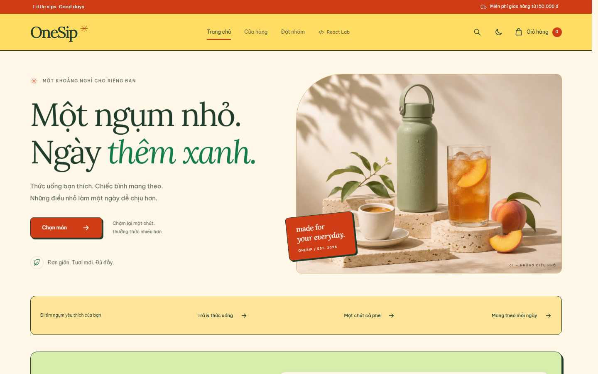

# OneSip

MVP cửa hàng **React** cho SE347.R13: thức uống, bình nước và những khoảng nghỉ dễ chịu. Giao diện cam quýt – vàng nắng – xanh lá, ảnh sản phẩm riêng, animation có reduced motion và skeleton khi tải nội dung.



## Chạy ứng dụng

Node đã dùng: **22.17.0**. Repo hỗ trợ Node22.17+ trong nhánh22 hoặc Node24+.

```powershell
npm ci
npm run build
npm run preview
```

Mở **[OneSip tại localhost:4173](http://127.0.0.1:4173/)**. Khi phát triển chạy `npm run dev`. Sau khi cài/build, ảnh, font và mã QR đều chạy local; không cần tài khoản, API ngân hàng hoặc Internet để demo. Không mở `dist/index.html` trực tiếp qua `file://`.

## MVP có gì

- Home và catalog12 sản phẩm; tìm tiếng Việt không phân biệt dấu, lọc và sắp xếp.
- Trang chi tiết, chọn số lượng, cart drawer/trang giỏ, giới hạn tồn mẫu, lưu giỏ qua reload.
- Guest checkout có validation, thông tin mẫu, retry, chống tạo đơn lặp và hủy khi rời trang.
- VietQR **MBBank – 0825730557** chỉ hiện sau khi bấm **Đặt hàng**; tạo local, chỉnh số tiền sẽ tạo lại mã. Có tải ảnh QR và sao chép tài khoản.
- Biên nhận đơn mẫu, khôi phục đơn gần nhất trong phiên. Chuyển khoản luôn ghi **chờ xác nhận**, không tự báo đã nhận tiền.
- Responsive, dark mode, thao tác bàn phím, native dialog, loading skeleton cho route/ảnh/QR.
- [React Lab](http://127.0.0.1:4173/#/learn) giữ sân chơi code bên trái/kết quả bên phải và các bài props/state, Context, `React.memo`.

Đây là **frontend MVP**: chưa có backend quản lý đơn, kho dùng chung, xác thực hoặc webhook đối soát ngân hàng. Không cần chuyển tiền để trải nghiệm. QR dùng tài khoản thật; cần kiểm tra người nhận/số tiền trong ứng dụng ngân hàng trước giao dịch. Chưa kiểm bằng app ngân hàng thật.

## Một lượt demo nhanh

Thêm **Bình nước ×2 + Trà đào ×1** → giỏ 3 đơn vị, tiền hàng 125.000đ, phí 20.000đ, tổng **145.000đ**. Mở checkout, bấm **Điền thông tin mẫu** rồi **Đặt hàng**. QR xuất hiện trên trang biên nhận; thử đổi số tiền thành 250000 rồi trả về 145000.

Trong React Lab, cùng fixture hiển thị **125.000đ** chưa có phí; gõ `react` sau Bắt đầu phép đo cho **5/0**, Đổi dữ liệu cho **6/1**. Playground tiếp tục dùng source thật, có live edit, lỗi biên dịch và reset code.

## Hướng dẫn và kiểm tra

- [Hướng dẫn sử dụng, QR, reset và trình diễn](docs/onesip-guide.md).
- [Kết quả kiểm tra MVP](docs/onesip-verification.md).
- [Nguồn ảnh, font và prompt](docs/design/asset-manifest.md).
- [Kịch bản seminar React](docs/demo-script.md): bắt đầu ở `/learn`.
- [Nhật ký quyết định triển khai](docs/onesip-implementation.md).

```powershell
npm run lint
npm test
npm run build
npm run test:e2e
```

Test E2E dùng production preview4173. Đảm bảo preview phục vụ `dist` mới nhất. Vitest kiểm state/cart, checkout, receipt hỏng, TLV/CRC và giải mã ảnh QR độc lập; Playwright kiểm mua hàng, loading, QR chỉnh tiền, retry/abort, bàn phím, viewport và hồi quy lesson.

## Cấu trúc chính

```text
src/storefront/           storefront, catalog, cart, checkout, QR và giao diện
src/features/learn/      shell Playground và CSS riêng
src/lessons/             mã React sửa trực tiếp trong bài giảng
src/playground/          compiler và editor, lazy-load khi vào /learn
public/images/storefront ảnh WebP local
public/fonts/            font local và giấy phép OFL
```

Cấu hình tài khoản nhận ở `src/storefront/checkout/vietqr.js`; giữ account dạng chuỗi. Palette ở `src/tokens.css` và phần bright edition trong `src/storefront/storefront.css`. Ảnh/font và dữ liệu lesson độc lập với catalog storefront.

Nhánh làm việc: **`feat/complete-storefront`**, tách từ `main@57f3fcc`. Không push/merge vào `develop`. Không có deploy tự động trong thay đổi này. Mã nguồn minh họa theo MIT; ảnh AI và font có nguồn riêng trong asset manifest.
