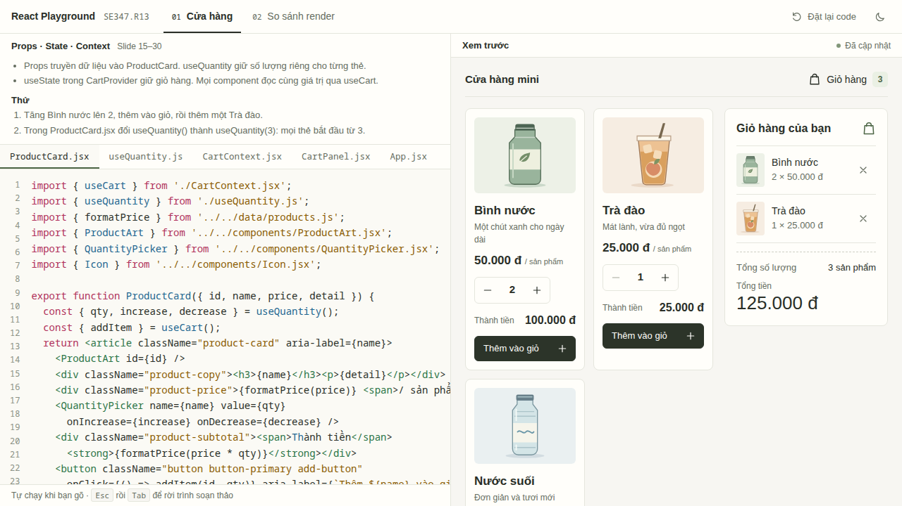

# React Playground — SE347.R13

Một sân chơi React (code bên trái, kết quả bên phải) với một cửa hàng nhỏ để minh họa **props/state, Context và React.memo** trong một lượt demo 5–10 phút. Chuẩn bị cho seminar ngày **18/11/2026**, người phụ trách demo: **Trần Hữu Quốc Hướng**.



## Chạy demo

Máy đã xác minh: **Node 22.17.0**, npm 10.9.2. Dùng Node 22.17 trở lên trong nhánh 22 hoặc Node 24+.

```powershell
cd D:\Hoc\HK5\SE347-React-Seminar-Demo
npm ci
npm run build
npm run preview
```

Mở **[http://127.0.0.1:4173](http://127.0.0.1:4173)**. Giữ terminal chạy. Chuẩn bị trước giờ lên trình bày; đến lượt demo chỉ cần chạy `npm run preview` và mở trình duyệt.

`npm ci` cần Internet trong lần chuẩn bị. Sau khi đã cài và build, app chỉ dùng file local, không cần mạng ngoài, tài khoản, API hoặc extension trình duyệt. Nếu cổng 4173 đang được sử dụng, preview báo lỗi để bạn xử lý trước khi trình bày.

Để phát triển và sửa code: `npm run dev`, mở cổng 5173. **Lúc trình bày dùng preview**, vì số đếm được xác minh trên production build. Không mở `dist/index.html` bằng `file://`.

## Cách dùng

Màn hình chia đôi: **code bên trái, kết quả bên phải**. Sửa code, khoảng 0,3 giây sau phần xem trước tự chạy lại. Nếu code sai cú pháp, lỗi hiện ngay dưới trình soạn thảo và bản chạy gần nhất vẫn được giữ. **Đặt lại code** khôi phục code gốc của bài đang mở. Nút sáng/tối ở góc phải. Trong trình soạn thảo, `Tab` thụt lề, `Shift+Tab` bỏ thụt lề, `Esc` rồi `Tab` để rời khỏi.

## Một lượt trình bày

1. **Props và state:** tăng Bình nước lên 2. Thành tiền là 100.000 đ; hai thẻ còn lại vẫn giữ số lượng 1. Trong `ProductCard.jsx` đổi `useQuantity()` thành `useQuantity(3)` để thấy mọi thẻ bắt đầu từ 3.
2. **Context:** thêm Bình nước ×2 và Trà đào ×1. Huy hiệu là **3**, giỏ có **2 dòng**, tổng **125.000 đ**. Mở tab `CartContext.jsx` để giải thích nguồn state chung.
3. **memo:** chuyển sang **So sánh render**, bấm **Bắt đầu phép đo**, gõ từng ký tự `react`. Kết quả **5 / 0**. Bấm **Đổi dữ liệu**, kết quả **6 / 1**. Trong `SalesChart.jsx` đổi `memo(SalesChart)` thành `SalesChart` rồi đo lại: hai bên cùng tăng.

Mỗi bài giữ code đã sửa khi chuyển qua lại giữa hai bài; tải lại trang sẽ xóa mọi chỉnh sửa. Ghi chú không ảnh hưởng dữ liệu biểu đồ; bộ đếm ghi lại Effect theo dõi sau commit, không đếm mọi lần gọi hàm render hoặc số nút DOM bị sửa. Mỗi lần code chạy lại, phần xem trước được dựng lại từ đầu và bộ đếm về 0.

## Tài liệu để tập trước buổi seminar

| Tài liệu | Dùng khi |
| --- | --- |
| [Kịch bản 5 / 7 / 10 phút](docs/demo-script.md) | Tập lời nói và từng thao tác |
| [Đối chiếu slide với mã nguồn](docs/slide-mapping.md) | Nối phần demo với nội dung nhóm trình bày |
| [Checklist diễn tập và xử lý sự cố](docs/rehearsal.md) | Chuẩn bị trước ngày và trước giờ lên demo |
| [Câu hỏi đáp](docs/qa.md) | Ôn các câu hỏi dễ được hỏi |
| [Quyết định thiết kế](docs/design-notes.md) | Hiểu giao diện và phần đo được tổ chức ra sao |
| [Bằng chứng kiểm tra](docs/verification.md) | Xem số liệu, môi trường và giới hạn đã xác minh |
| [Video dự phòng khoảng 5 phút](backup/demo-5min.mp4) | Phát file local và tự thuyết minh khi app gián đoạn |

Video không có lời, để bạn nói theo kịch bản. Tải về hoặc mở file local để phát, không phụ thuộc khả năng preview MP4 của GitHub. Ba ảnh dự phòng cũng nằm trong thư mục [backup](backup/).

## Kiểm tra và quay lại video

```powershell
npm run lint
npm test
npm run build
npx playwright install chromium
npm run test:e2e
```

Unit/component tests kiểm trình biên dịch trong trình duyệt, state, giỏ, bộ đo và luồng sửa code. Playwright chạy luồng thật trên preview: sửa code và thấy kết quả, lỗi cú pháp, đặt lại, thao tác bàn phím trong trình soạn thảo, theme, request chỉ về localhost, bố cục chia đôi ở 1280×720, 1366×768, 1920×1080 và bố cục điện thoại 390×844. Cấu hình tự khởi động preview nếu chưa chạy.

Để quay lại video: khởi động preview ở một terminal, rồi chạy `npm run record` ở terminal khác. Script điều khiển app thật khoảng 5 phút, xác nhận số đo và tạo MP4 bằng ffmpeg. Phần quay dùng Playwright và ffmpeg-static trong dev dependencies; các gói này không được gửi vào bản web build.

## Cấu trúc cần biết

```text
src/lessons/shop/*                       code học viên sửa được ở bài 1 (ProductCard, useQuantity, CartContext, CartPanel, App)
src/lessons/render/*                     code sửa được ở bài 2 (SalesChart, App)
src/lessons/index.js                     danh sách bài, ghi chú, file nào hiện ở tab nào
src/playground/compile.js                biên dịch JSX bằng sucrase và chạy các file trong trình duyệt
src/playground/Playground.jsx            trình soạn thảo bên trái, xem trước bên phải
src/features/render/metricsStore.js      kho số liệu quan sát tách riêng
src/components, src/data                 phần dùng chung, không sửa trong bài
src/tokens.css                           màu, font và màu cú pháp của cả hai theme
```

Các file trong `src/lessons` là module thật với import tương đối thật; chính chúng được nạp bằng `?raw` vào trình soạn thảo và chạy lại khi bạn sửa. Chỉ import `react` và các file trong bài (hoặc các module dùng chung có sẵn trong `src/components`, `src/data`).

Không bật React Compiler để minh họa riêng tác dụng của `memo`. Không dùng Redux/Zustand/Next.js cho demo nhỏ này. Đây là ví dụ giảng dạy; dữ liệu chỉ giữ trong bộ nhớ và được xóa khi tải lại trang.

Nhánh `main` là bản diễn tập ổn định, `develop` dành cho tích hợp, thay đổi mới làm qua nhánh `feat/...`. Code mới được phát hành theo [MIT](LICENSE). Slide nguồn không nằm trong repo public; chỉ đối chiếu tên và số slide.
