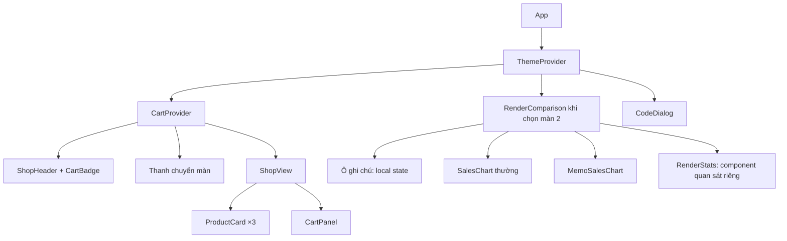
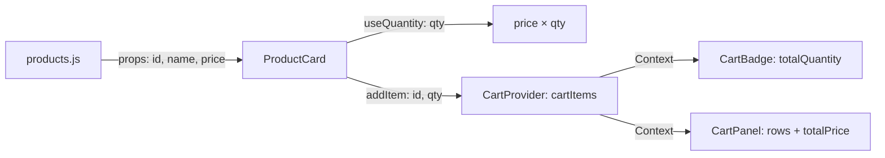

# Thiết kế chi tiết demo React — SE347.R13

Ngày thiết kế: **03/11/2026**, múi giờ Asia/Saigon. Ngày trình bày: **18/11/2026**.

Tài liệu này là đầu ra của giai đoạn thiết kế. Ứng dụng, repo GitHub và video sẽ được tạo ở giai đoạn triển khai. Bản phác thảo đi kèm là HTML tĩnh, các số trên đó là trạng thái minh họa.

## 1. Những gì người dùng đã chốt

- Quốc Hướng phụ trách lead demo; nội dung phải bám các ví dụ trong slide seminar React.
- Trình bày một lượt liên tục, dài **5–10 phút**, bằng ứng dụng đã chuẩn bị trước và giải thích code có sẵn.
- Xây mới một cửa hàng mini, tạo repo GitHub riêng và **public**.
- Người trình bày đã học React beginner qua Codecademy. Code và lời giải thích phải phù hợp với nền tảng đó.
- Có mã nguồn, hướng dẫn chạy, kịch bản nói, hướng dẫn tập, Q&A và video dự phòng.
- Không có yêu cầu bắt buộc về backend, API hay thư viện. Người dùng giao các lựa chọn còn lại cho agent.

Các quyết định ở các mục tiếp theo do agent lựa chọn, không phải những yêu cầu bổ sung từ giảng viên. Không tự phân công lại công việc của bốn thành viên còn lại; Quốc Hướng điều phối phần seminar theo `AGENTS.md` môn học.

## 2. Mục tiêu và giới hạn

Sau lượt demo, người nghe cần giải thích được ba việc:

1. Props cấu hình thẻ sản phẩm; state ghi nhớ số lượng; giao diện và thành tiền được tính từ dữ liệu hiện tại.
2. State giỏ hàng có một nơi quản lý, các component dùng Context đọc cùng nguồn dữ liệu.
3. Component cha cập nhật có thể làm con render lại; `memo` có thể bỏ qua việc đó khi props không đổi.

Ứng dụng gồm **hai màn trong cùng một trang**: Cửa hàng và So sánh render. Chặng 1 và 2 diễn ra ở màn Cửa hàng; chặng 3 chuyển một lần sang So sánh render. Đây là một câu chuyện liên tục trong cùng ứng dụng.

Phạm vi có: danh sách sản phẩm, chọn số lượng, giỏ hàng, theme sáng/tối, xem code, so sánh render, đặt lại demo. Phạm vi không bao gồm thanh toán, đăng nhập, lưu đơn, quản trị, backend, Redux, Zustand, TanStack Query, Next.js, React Server Components hay triển khai website công khai. Những phần ngoài phạm vi vẫn thuộc nội dung lý thuyết của deck.

Thành công được đánh giá bằng kết quả quan sát đúng, lời giải thích rõ và khả năng lặp lại toàn bộ lượt demo; không đặt mục tiêu chứng minh một mức tăng tốc tính bằng phần trăm.

## 3. Nguồn slide và đối chiếu nội dung

Nguồn được kiểm tra: `Seminar React SE347.R13.pptx`, **58 slide**, bản tại `C:/Users/ADMIN/Downloads/`.

SHA-256: `FAFE6CF6AE93402575E33FA9DC724FE526D9281EF8803EEB223B9D1C22B28AB8`.

| Chặng | Thao tác trong ứng dụng | Ví dụ trong slide | Điều cần nói rõ |
| --- | --- | --- | --- |
| 1 | Quan sát ba thẻ sản phẩm dùng cùng cấu trúc | 7 — ghép Component; 19 — danh sách | Một `ProductCard` được dùng lại; `key` lấy từ ID ổn định |
| 1 | Tăng số lượng Bình nước từ 1 lên 2 | 17 — `ProductCard`; 21 — `useState` | Tên/giá là props, số lượng là local state, thành tiền là giá trị suy ra |
| 1 | Chỉ vào các nút tăng/giảm ở thẻ khác | 26 — `useQuantity` | Custom Hook dùng lại logic, mỗi lần gọi giữ state độc lập |
| 2 | Thêm hàng rồi quan sát huy hiệu và giỏ cùng đổi | 15 — dữ liệu một chiều; 28, 30, 37 — chia sẻ state | `useState` trong Provider giữ dữ liệu; Context truyền dữ liệu, không tự tạo state |
| 2, tùy thời lượng | Đổi sáng/tối một lần | 23 — theme qua `useContext` | Theme là một ví dụ Context thứ hai; không cần mở thêm code |
| 3 | Gõ ghi chú không liên quan đến biểu đồ | 38, 39 — cha đổi state, con chạy lại | Render lại không đồng nghĩa toàn bộ DOM bị thay thế |
| 3 | So sánh cùng biểu đồ thường và biểu đồ bọc `memo` | 40, 42 — `React.memo` | Props phải giữ nguyên; memo là tối ưu, không phải quy tắc chặn mọi cập nhật |
| 3, mở rộng | Đổi dữ liệu biểu đồ, cả hai cùng cập nhật | 40, 41 — so sánh props | Dữ liệu đổi thật thì component đã memo vẫn cần cập nhật |

Giỏ hàng bằng Context là ví dụ kết hợp phù hợp với phần 5; **không gọi đây là ví dụ Redux/Zustand của slide**. Ví dụ `useMemo`/`useCallback` ở slide 24, 41 chỉ dùng để trả lời Q&A khi cần; không đưa thêm vào luồng chính.

## 4. Bố cục và cách trình chiếu

Bản phác thảo: [2026-11-03-react-seminar-demo-wireframes.html](./2026-11-03-react-seminar-demo-wireframes.html). Ba khung tĩnh thể hiện cửa hàng ban đầu, giỏ sau thao tác và màn so sánh render. Đây là các trạng thái của một thiết kế đã chọn.

- Header: tên **React Mini Shop**, nhãn `SE347.R13`, nút đổi theme và **Đặt lại demo**.
- Thanh chuyển màn: **Cửa hàng** và **So sánh render**. Không dùng router hay đổi sang ứng dụng khác.
- Màn Cửa hàng: vùng sản phẩm bên trái, giỏ hàng luôn nhìn thấy bên phải. Huy hiệu giỏ ở header và tổng số lượng trong giỏ là hai nơi cùng đọc Context.
- Màn So sánh render: một ô ghi chú, hai biểu đồ giống nhau đặt cạnh nhau, hai số lượt cập nhật và nút **Bắt đầu phép đo** / **Đổi dữ liệu**.
- Mỗi màn có **Xem code**. Bật lên một hộp thoại lớn chứa đoạn code ngắn, tối đa khoảng 22 dòng. Đóng bằng nút hoặc Escape, trả focus về nút mở. Dùng `dialog` chuẩn và giữ tiêu đề cho trình đọc màn hình.
- Trạng thái mở/đóng nằm trong `CodeDialog` hoặc launcher riêng, không đặt ở `App` hay `RenderComparison`. Mở code sau phép đo không được làm component cha của hai biểu đồ render lại và làm lệch kết quả.
- Màn Cửa hàng có hai mục code: **Props và state**, **Context giỏ hàng**. Màn so sánh có **Trước và sau memo**. Người trình bày chỉ cần nhớ ba mục này.

Ưu tiên nhìn rõ trên máy chiếu: kiểm tra ở **1280×720** và **1366×768**, font nội dung 18–20 px, code khoảng 20 px, số kết quả 36–44 px, vùng bấm ít nhất 44 px. Không cần cuộn dọc để hoàn thành thao tác chính ở các kích thước trên. Dưới 900 px, sản phẩm và giỏ xếp dọc; bản mobile dùng để xem lại, không phải bố cục thuyết trình chính.

Phong cách: nền sáng, bề mặt phẳng, viền nhẹ, một màu nhấn xanh; có theme tối để đọc trong điều kiện phòng khác nhau. Font hệ thống `Segoe UI, Arial, sans-serif`; code dùng `Consolas, monospace`. Dùng nhãn tiếng Việt, tên component và code bằng tiếng Anh. Hình minh họa nếu có là SVG nội bộ, không dùng CDN, ảnh từ xa hay font tải mạng. Không có animation trang trí hoặc thông báo tự biến mất trong luồng demo.

## 5. Dữ liệu và quy tắc nghiệp vụ

| ID | Tên | Đơn giá | Số lượng chọn ban đầu |
| --- | --- | ---: | ---: |
| `P01` | Bình nước | 50.000 đ | 1 |
| `P02` | Trà đào | 25.000 đ | 1 |
| `P03` | Nước suối | 10.000 đ | 1 |

- Giá lưu bằng số nguyên VND; hiển thị với `Intl.NumberFormat('vi-VN')` và hậu tố `đ`.
- `useQuantity` giới hạn số lượng chọn từ **1 đến 10**; nút giảm ở 1 và tăng ở 10 bị khóa. Chọn ở một thẻ không đổi thẻ khác.
- Bấm Thêm vào giỏ cộng số lượng đang chọn vào dòng có cùng ID; không tạo các dòng trùng ID. Số lượng đã thêm không đặt lại số lượng đang chọn trên thẻ.
- Giỏ chỉ có thao tác **Thêm** và **Xóa dòng**. Không thêm một bộ tăng/giảm thứ hai trong giỏ; giữ một cách giải thích local state.
- Huy hiệu hiển thị **tổng số đơn vị**, không phải số loại sản phẩm. `totalQuantity` và `totalPrice` đều tính từ `cartItems`, không lưu thành state riêng.
- Giỏ trống có thông điệp cố định; tổng số lượng và tổng tiền bằng 0. Xóa một dòng loại bỏ toàn bộ số lượng của dòng đó.
- Dữ liệu giỏ, số lượng chọn, tab và theme chỉ nằm trong bộ nhớ. **Đặt lại demo** tải lại trang local và trả mọi thứ về trạng thái ban đầu: giỏ trống, mỗi thẻ 1, tab Cửa hàng, theme sáng.
- Chuyển màn giữ giỏ hàng qua Provider ở cấp ứng dụng. State của màn bị gỡ được khởi tạo lại khi trở về; kịch bản chính chỉ đi Cửa hàng → So sánh render, không dựa vào việc giữ local state khi quay lại.

Kết quả kiểm tra cố định: Bình nước ×2 = **100.000 đ**; thêm vào giỏ → huy hiệu **2**, tổng **100.000 đ**; thêm Trà đào ×1 → huy hiệu **3**, hai dòng, tổng **125.000 đ**; xóa Bình nước → huy hiệu **1**, tổng **25.000 đ**.

## 6. Công nghệ và cấu trúc mã nguồn

Chọn **React + Vite + JavaScript**, CSS thuần. Dùng React ổn định trong nhánh 19, phiên bản Vite tương thích Node LTS của máy khi triển khai; khóa phiên bản thực tế bằng `package-lock.json` và ghi Node đã xác minh vào `.nvmrc`/README. Không dùng prerelease. Không bật React Compiler cho repo giảng dạy này để thấy riêng tác dụng của `memo`.

Không thêm thư viện state, router, UI hay biểu đồ. SVG đơn giản đủ thể hiện biểu đồ cột. `useQuantity` bám ví dụ slide; `useCart` và `useTheme` bọc cách đọc Context và báo lỗi nếu thiếu Provider. Chưa cần `useReducer` cho ba thao tác giỏ hàng nhỏ.

```text
src/
  main.jsx
  App.jsx
  styles.css
  data/products.js
  data/sales.js
  context/CartContext.jsx
  context/ThemeContext.jsx
  hooks/useQuantity.js
  components/ShopHeader.jsx
  components/ProductCard.jsx
  components/CartPanel.jsx
  components/CodeDialog.jsx
  features/shop/ShopView.jsx
  features/render/RenderComparison.jsx
  features/render/SalesChart.jsx
  features/render/RenderStats.jsx
  features/render/metricsStore.js
  teaching/codeExamples.js
```

Quy mô dự kiến khoảng 15–18 file nguồn, chỉ ba vùng cần mở code khi nói. Comment trong code bằng tiếng Anh. Nội dung trong `docs/` và hướng dẫn người trình bày bằng tiếng Việt.

### Cây component



`CartProvider` bọc phần cửa hàng và huy hiệu; ví dụ render nằm ngoài Cart Context. CSS theme áp lên phần tử gốc, hai biểu đồ không đọc Theme Context. `RenderStats` là component riêng đặt cạnh từng biểu đồ trong khung so sánh; nó tự subscribe kho đo. Không chuyển số đo thành state của `RenderComparison` hoặc `SalesChart`: khi số đo đổi, chỉ component quan sát cần cập nhật.

### Dữ liệu đi đâu



| Thành phần | Sở hữu dữ liệu / hợp đồng |
| --- | --- |
| `App` | Chọn màn; không sở hữu các số đếm phép đo |
| `ProductCard({ id, name, price })` | Props chỉ đọc; `useQuantity(1, 10)` giữ `qty`; gọi `addItem(id, qty)` |
| `CartProvider` | `cartItems: [{ productId, quantity }]`; cung cấp `addItem`, `removeItem`, `totalQuantity`, `totalPrice`; tra giá từ dữ liệu sản phẩm |
| `ThemeProvider` | `theme`, `toggleTheme`; đồng bộ `data-theme` của gốc bằng Effect; không dùng lưu trữ trình duyệt |
| `RenderComparison` | `note`, `dataset`; hai bản biểu đồ nhận cùng tham chiếu dữ liệu cho đến khi bấm Đổi dữ liệu |
| `SalesChart({ data, metricId })` | Chỉ nhận props, không đọc Context, không có state thay đổi theo ghi chú; tổng hợp dữ liệu và vẽ SVG |
| `metricsStore` | Số liệu quan sát; chỉ `RenderStats` subscribe, không làm cha/hai biểu đồ cập nhật theo nó |

Tổng tiền và số lượng luôn tính từ nguồn dữ liệu hiện tại. Cập nhật mảng giỏ bằng functional setter và tạo mảng/object mới. Dùng `key={product.id}` cho sản phẩm, `key={item.productId}` cho dòng giỏ.

## 7. Thiết kế so sánh render cho kết quả có ý nghĩa

Màn này kế thừa tình huống `Page` có state `text` và `HeavyChart` ở slide 39. Ô nhập đặt tên **Ghi chú đơn hàng** để thấy rõ ghi chú không đổi dữ liệu bán hàng.

### Hai bản cùng điều kiện

- `SalesChart` và `MemoSalesChart = memo(SalesChart)` được khai báo ở phạm vi module, không tạo bên trong component cha.
- `RenderComparison` tạo JSX của cả hai trực tiếp trong mỗi render. Không đặt hai bản trong hai cây cha có cách memoization khác nhau.
- Cả hai nhận cùng `data` và ID đo dạng string ổn định; không truyền object, mảng hay callback tạo mới mỗi lần gõ.
- `dataset` được tạo một lần ở initial state. Nút **Đổi dữ liệu** chuyển giữa hai bộ dữ liệu cố định, tạo tham chiếu mới có nội dung khác.
- Dữ liệu gồm khoảng 1.000 bản ghi bán hàng được sinh từ công thức cố định, tổng hợp thành sáu cột SVG. Không dùng ngẫu nhiên, gọi API, vòng lặp chờ hay cố tình làm treo giao diện.
- Kết quả chính là **số lượt cập nhật quan sát được**, không phải số mili-giây. Không tuyên bố component bọc memo nhanh hơn mọi lúc.

### Cách đo đã chọn

Nhãn giao diện: **Lượt cập nhật sau mốc đo**. Mỗi `SalesChart` có một Effect theo dõi không truyền dependency array, gửi sự kiện vào `metricsStore` sau mỗi lần component đó commit. Ghi chú nhỏ giải thích đây là số lần Effect theo dõi chạy sau commit, không phải số lần gọi hàm render hay số nút DOM bị sửa.

`metricsStore` đặt ngoài cây component và phát snapshot bất biến; `RenderStats` subscribe bằng `useSyncExternalStore`. Các component được đo và cha của chúng **không subscribe** kho này. `RenderStats` là component con riêng, cập nhật của nó không được truyền thành state của cha hoặc props của biểu đồ. Nhờ đó cập nhật bảng số không kích hoạt lại chính ví dụ đang đo. Không tăng state hoặc ghi `ref.current` trong thân render để đếm. Phần đo tách khỏi ba đoạn code giảng chính.

**Bắt đầu phép đo** chỉ đặt lại kho số liệu, không đổi props hay remount biểu đồ. Bấm sau khi màn đã hiển thị ổn định; loại phần khởi tạo khỏi phép so sánh. Nút **Đổi dữ liệu** làm cả hai cùng cập nhật; đây là bước kiểm chứng memo vẫn phản hồi dữ liệu mới.

Khi trình chiếu dùng bản **production build được phục vụ bằng Vite preview**. Effect theo dõi vẫn hoạt động ở bản này. Giữ `StrictMode` khi phát triển; không đọc số mount ở dev thành số render của bản trình chiếu. Không dùng React `<Profiler>` làm bộ đếm chính vì profiling bị tắt mặc định trong production thông thường. Không bật React Compiler cho ví dụ này.

### Kết quả đích sau từng thao tác

| Thao tác sau khi màn ổn định | Bản thường | Bản memo |
| --- | ---: | ---: |
| Bắt đầu phép đo | 0 | 0 |
| Gõ lần lượt năm ký tự `react` | 5 | 0 |
| Bấm Đổi dữ liệu một lần | 6 | 1 |

Các giá trị này là **tiêu chí phải xác minh khi triển khai**, chưa phải kết quả đã đo. Để lặp đúng năm lần, kịch bản ghi rõ gõ từng ký tự, không dán cả từ. Kiểm thử trình duyệt gửi từng ký tự và chờ giao diện cập nhật. Nếu môi trường đã xác minh có cách gộp cập nhật khác, không bịa số: sửa nhãn/kịch bản theo kết quả thực và giữ bằng chứng khác biệt cùng việc hai bản cập nhật khi props đổi.

## 8. Xem code trong ứng dụng

Ba mục code lấy trực tiếp từ file nguồn bằng Vite `?raw`, cắt theo vùng comment `demo:start` / `demo:end`. Không duy trì một bản snippet chép tay có thể lệch logic thực. Có kiểm tra ở build/test rằng mỗi vùng nguồn tồn tại đúng một lần.

- **Props và state:** đoạn `ProductCard` thể hiện dữ liệu đầu vào, `useQuantity`, callback nút tăng, `price * qty`. Tối đa khoảng 22 dòng.
- **Context giỏ hàng:** đoạn tạo Provider và hai consumer; phần tính toán/hỗ trợ có thể được lược khỏi vùng đánh dấu nhưng code hiển thị phải đúng với nguồn. Mỗi phần có nhãn file rõ ràng.
- **Trước và sau memo:** dùng một thân `SalesChart` và dòng bọc `memo`; phần đo hỗ trợ đóng lại phía sau, không đưa vào nội dung thuyết trình chính.

Không thêm editor chạy code hay hot reload vào giao diện trình chiếu. README vẫn chỉ ra đường dẫn file thật để xem trong VS Code khi tự học hoặc trả lời câu hỏi.

## 9. Kịch bản chính — 7 phút

| Mốc thời gian | Thao tác | Lời dẫn / kết luận |
| --- | --- | --- |
| 0:00–0:30 | Màn Cửa hàng ở trạng thái ban đầu | “Em dùng cùng một cửa hàng nhỏ để minh họa dữ liệu đi vào component, state thay đổi và cách React cập nhật giao diện.” |
| 0:30–1:20 | Tăng Bình nước lên 2, chỉ sang hai thẻ còn lại | “Tên và giá do cha truyền xuống. Số lượng là state riêng của thẻ. Thành tiền được tính từ giá nhân số lượng; các thẻ khác vẫn giữ số lượng của chúng.” |
| 1:20–2:10 | Mở Props và state, chỉ đúng ba dòng, đóng code | “Hook dùng lại logic tăng giảm, còn mỗi thẻ có state riêng. Khi state đổi, React tính lại giao diện tương ứng.” |
| 2:10–3:00 | Thêm Bình nước ×2 rồi Trà đào ×1 | Chỉ huy hiệu 3, hai dòng giỏ và tổng 125.000 đ; “Các vị trí này cùng đọc một nguồn dữ liệu giỏ hàng.” |
| 3:00–3:45 | Mở Context giỏ hàng, đóng code | “State nằm trong Provider. Context giúp component cần dùng đọc được dữ liệu mà không truyền props qua mọi tầng.” |
| 3:45–4:10 | Chuyển sang So sánh render; đợi ổn định, bấm Bắt đầu phép đo | “Giờ em xét một ô ghi chú và biểu đồ không phụ thuộc ghi chú đó.” |
| 4:10–4:55 | Gõ từng ký tự `react`; chỉ hai số đo | “Cha đổi state theo từng ký tự. Bản thường cập nhật lại; bản memo có thể dùng lại kết quả vì dữ liệu truyền vào chưa đổi.” |
| 4:55–5:40 | Mở Trước và sau memo, chỉ vị trí bọc, đóng code | “Hai bản nhận cùng dữ liệu. Điểm khác là một bản được bọc memo. Đây là tối ưu khi props phù hợp, không phải cách ngăn mọi cập nhật.” |
| 5:40–6:15 | Bấm Đổi dữ liệu, quan sát cả hai | “Khi dữ liệu đổi thật, bản memo vẫn cập nhật đúng. Render lại cũng không có nghĩa toàn bộ DOM bị dựng lại.” |
| 6:15–7:00 | Kết thúc ở màn so sánh | Nhắc ba ý: props/state; Context dùng chung nguồn dữ liệu; tối ưu dựa trên việc quan sát và hiểu props. Dành phần còn lại cho chuyển lời sang nhóm. |

Kịch bản thực tế sẽ được diễn tập có bấm giờ. Nếu nói dài, ưu tiên bỏ phần chỉ code phụ trước khi bỏ một trong ba kết luận học thuật.

**Bản 5 phút:** mở bài 20 giây; props/state 70 giây; giỏ/Context 80 giây; memo gồm phép đo và đổi dữ liệu 110 giây; kết 20 giây. Vẫn thao tác đủ ba chặng; code Context chỉ chỉ vùng Provider/consumer, không giải thích chi tiết các hàm giỏ.

**Bản tối đa 10 phút:** giữ luồng 7 phút; thêm tối đa 1 phút giải thích hai lần gọi Custom Hook độc lập, 45 giây đổi theme liên hệ slide 23, 45 giây giải thích tham chiếu props/memo, 30 giây dự phòng. Không thêm thư viện hoặc một ứng dụng khác.

## 10. Trạng thái và thao tác cần xử lý

| Trạng thái / thao tác | Kết quả |
| --- | --- |
| Giỏ trống | Hiện hướng dẫn Thêm vào giỏ, huy hiệu và tổng bằng 0 |
| Tăng/giảm đến giới hạn | Nút tương ứng bị khóa, không hiện số 0 hoặc âm |
| Bấm Thêm lặp lại | Cộng dồn đúng vào cùng ID, không mất lần bấm do state cũ |
| Xóa dòng cuối | Trở về trạng thái giỏ trống, tổng cập nhật đồng thời |
| Mở/đóng code | Không đặt lại giỏ, số lượng hoặc dữ liệu thống kê |
| Mở So sánh render | Khởi tạo hai bộ quan sát; chờ ổn định rồi bắt đầu đo |
| Đổi theme | Đổi màu bằng CSS; giữ giỏ; đặt lại mốc đo trước khi thực hiện phép so sánh mới |
| Đặt lại demo / refresh | Khôi phục đầy đủ trạng thái ban đầu, không cần xóa storage |

Không có loading/error API trong luồng chính vì dữ liệu nằm cùng bản build. Nếu trình duyệt không mở được app local, xử lý theo mục dự phòng thay vì tiếp tục sửa code trước lớp.

## 11. Chạy ổn định và dự phòng

Các script cần có khi triển khai: `npm run dev`, `npm run lint`, `npm run test`, `npm run build`, `npm run preview`. Preview cố định `127.0.0.1:4173`, bật strict port để phát hiện xung đột trước khi trình bày. Không cài package hoặc build trong giờ demo.

- Trước ngày trình bày: cài bằng `npm ci`, chạy kiểm tra, build và chạy hết lượt demo trong preview.
- Trước giờ vào phần demo: khởi động preview, mở đúng tab, đặt lại demo, thử một lần rồi đặt lại, kiểm tra cỡ chữ trên máy chiếu. Giữ terminal preview chạy trong suốt lượt trình bày.
- Kiểm tra mất Internet bằng cách chặn các origin bên ngoài nhưng vẫn cho phép localhost. Không dùng chế độ Offline của DevTools nếu nó chặn luôn request tới server local.
- Nếu có lỗi: thử Đặt lại demo một lần. Nếu server chưa chạy, khởi động lại bằng lệnh đã lưu sẵn. Sau tối đa khoảng 20 giây chưa khôi phục được thì chuyển sang video; không sửa source trực tiếp trước lớp.
- Video MP4 720p hoặc cao hơn, lưu local; quay từ bản preview đã kiểm tra, đi đúng ba chặng, thấy rõ số tiền và số đo, con trỏ đủ rõ. Ưu tiên video không lời dài khoảng 5 phút để người trình bày tự thuyết minh, không yêu cầu TTS.
- Có thêm ba ảnh tĩnh: Bình nước ×2; giỏ 125.000 đ; số đo trước/sau đổi dữ liệu. Ảnh là phương án khi video không phát được.

README ghi rõ app cần local HTTP server; không hướng dẫn mở `dist/index.html` bằng `file://`.

## 12. Kiểm tra cần thực hiện ở giai đoạn triển khai

Không viết test để kiểm màu hoặc lặp lại từng dòng JSX. Tập trung vào các kết quả có thể làm sai phần giải thích:

1. `useQuantity`: giới hạn 1–10; hai lần dùng giữ state độc lập.
2. Giỏ: thêm trùng ID, nhiều lần bấm liên tiếp, số đơn vị, tổng tiền và xóa dòng; xác nhận các giá trị cố định ở mục 5.
3. Trình duyệt trên **production preview**: làm toàn bộ luồng bằng các nút người dùng thấy, mở/đóng code, chuyển màn, thực hiện phép so sánh và xác nhận cả hai cập nhật khi props đổi.
4. Khẳng định màn đo hoạt động mà không cần React DevTools hay extension, không có vòng lặp cập nhật do bộ đếm.
5. Mọi request trong luồng demo ở localhost; ảnh, font và video không phụ thuộc Internet.
6. Kiểm tra không tràn ngang ở 1280×720, 1366×768 và một kích thước mobile; font, focus, Escape và nút đặt lại hoạt động.
7. `lint`, test và build qua; các vùng code hiển thị khớp source. Diễn tập bản 5 phút và 7 phút có ghi thời lượng thực.

Các công cụ dự kiến: Vitest + Testing Library cho logic/state và Playwright cho một lượt demo end-to-end. Phiên bản cụ thể do người triển khai chọn theo runtime tương thích và lockfile.

## 13. Câu hỏi đáp cần chuẩn bị

| Câu hỏi | Hướng trả lời |
| --- | --- |
| Props khác state ở đây thế nào? | Tên/giá nhận từ cha; số lượng được thẻ ghi nhớ và cập nhật bằng setter |
| Vì sao không lưu thành tiền thành state? | Nó tính được từ giá và số lượng; thêm state tạo thêm nguồn phải đồng bộ |
| Hai thẻ cùng dùng `useQuantity` có dùng chung số lượng không? | Không; Custom Hook dùng lại logic, mỗi lần gọi có state riêng |
| Context có phải một thư viện quản lý state? | Context truyền giá trị; state của ví dụ do `useState` trong Provider giữ |
| Vì sao dùng Context cho giỏ này? | Quy mô nhỏ và cần minh họa dữ liệu dùng ở nhiều vị trí; không kết luận mọi giỏ hàng nên dùng Context |
| Render lại có thay toàn bộ DOM không? | React tính mô tả UI mới rồi áp dụng thay đổi cần thiết; hai khái niệm khác nhau |
| Vì sao memo vẫn cập nhật khi bấm Đổi dữ liệu? | Prop `data` đã đổi; memo không bỏ qua một cập nhật có đầu vào mới |
| Memo có chặn state và Context không? | Không; state của chính component hoặc Context nó đọc đổi vẫn có thể làm nó cập nhật |
| Vì sao không memo tất cả? | Cần chi phí so sánh và quản lý props; cân nhắc theo tình huống và quan sát thực tế |
| Số đo có phải số lần gọi hàm component không? | Đây là lượt Effect theo dõi sau commit của ví dụ đã xác minh, không đếm mọi lần React thử render |
| Tại sao ở dev có thể thấy số khác? | StrictMode bổ sung các lần kiểm tra trong môi trường phát triển; dùng bản preview đã xác minh cho buổi demo |
| React Compiler liên quan gì? | Compiler có thể tự áp dụng memoization; repo giảng dạy không bật nó để tách riêng cơ chế đang minh họa |

## 14. Repo và các đầu ra triển khai

Tên repo đề xuất đã chọn: **`SE347-React-Seminar-Demo`**, public. Tài khoản dự kiến là `thqhuong` theo các remote môn học; người triển khai phải xác minh tài khoản GitHub đang đăng nhập trước khi tạo. Không ghi đè repo trùng tên, không copy toàn bộ workspace lên GitHub.

Đường dẫn local chọn: **`D:/Hoc/HK5/SE347-React-Seminar-Demo`**, nằm cạnh repo môn học để có Git độc lập. Repo môn học giữ tài liệu seminar và đường dẫn tới repo demo. Không khởi tạo một `.git` lồng trong repo môn học.

Dùng `main` cho bản diễn tập ổn định, `develop` cho tích hợp, nhánh `feat/...` khi triển khai. README bằng tiếng Việt; Conventional Commits bằng tiếng Anh. CI chỉ cần một workflow cài bằng lockfile, lint, test và build; không cần backend hay pipeline deploy. Giấy phép MIT cho mã minh họa mới. File PowerPoint nguồn không tự đưa vào repo public; dẫn tên và số slide trong tài liệu để đối chiếu.

| Đầu ra | Nội dung |
| --- | --- |
| `README.md` | Mục tiêu, cài/chạy, URL local, lệnh kiểm tra, kịch bản bắt đầu nhanh |
| `docs/demo-script.md` | Lời nói và thao tác cho bản 5/7/10 phút |
| `docs/slide-mapping.md` | Bảng slide → hành vi → file nguồn |
| `docs/rehearsal.md` | Đặt lại, số liệu đích, tập có giờ, xử lý sự cố |
| `docs/qa.md` | Câu hỏi ngắn và câu trả lời phù hợp ví dụ |
| `docs/superpowers/specs/…-design.md` | Bản thiết kế này được sao chép sang repo demo khi triển khai |
| `backup/demo-5min.mp4` và ba ảnh | Bản ghi local từ ứng dụng thực đã kiểm tra; nếu video lớn thì giữ file local và ghi đường dẫn trong hướng dẫn |

## 15. Thứ tự triển khai và tiêu chí bàn giao

1. Tạo repo local độc lập và khung React/Vite; khóa runtime và dependency.
2. Hoàn thành thẻ sản phẩm và giỏ; kiểm tra số liệu trước khi làm phần quan sát render.
3. Tạo màn so sánh với phép đo tách biệt; xác minh trên production preview trước khi viết lời dẫn theo con số.
4. Hoàn thiện code viewer, bố cục máy chiếu, theme và nút đặt lại.
5. Hoàn thiện tài liệu, diễn tập có giờ, quay video từ bản đã kiểm tra.
6. Kiểm tra toàn bộ đầu ra rồi tạo/push repo GitHub public theo tài khoản đã xác minh.

Bàn giao đạt khi người dùng có thể mở README, chạy preview, đặt lại và trình bày cả ba chặng mà không phải sửa code, cài thêm extension hay truy cập dịch vụ ngoài. Kết quả giỏ đúng bảng số liệu, phép so sánh có bằng chứng thực, có video và hướng dẫn tiếp tục khi gián đoạn.

## 16. Các lựa chọn còn giao cho người triển khai

Được tự quyết: phiên bản dependency ổn định tương thích, chi tiết icon/SVG, chia nhỏ file CSS và tên helper nội bộ. Có thể chỉnh bố cục để vừa màn hình, nhưng giữ ba chặng, số liệu mẫu, tính độc lập của phép đo và code giải thích dễ đọc. Nếu thay cách đo, phải ghi rõ ý nghĩa số hiển thị và kiểm chứng lại kịch bản, không dùng số mô phỏng làm kết quả thật.

## 17. Tài liệu kỹ thuật đã đối chiếu

- [React: `memo`](https://react.dev/reference/react/memo) — props, state/Context và ảnh hưởng của React Compiler.
- [React: `Profiler`](https://react.dev/reference/react/Profiler) — đo commit và hạn chế ở production build thông thường.
- [React: `StrictMode`](https://react.dev/reference/react/StrictMode) — các lần kiểm tra bổ sung ở môi trường phát triển.
- [React: Sharing State Between Components](https://react.dev/learn/sharing-state-between-components) — nguồn state chung và luồng dữ liệu.

Các trang trên được truy cập ngày 03/11/2026. Tài liệu React hỗ trợ lựa chọn kỹ thuật; không phải rubric chấm seminar.

## 18. Kiểm tra bản thiết kế

Ngày 03/11/2026: reviewer độc lập đã đọc đặc tả theo vai trò người sẽ lập kế hoạch triển khai và phản hồi **“nothing important left”**. Kiểm tra này đánh giá độ rõ của thiết kế; không thay cho kiểm thử ứng dụng ở mục 12.

Đã kiểm tra bản phác thảo ở chiều rộng 1280, 1366 và 390 px: không tràn ngang. Ở hai kích thước desktop, khung cửa hàng cao 646 px, khung so sánh cao 697 px, phù hợp mục tiêu viewport 720 px. Đã kiểm tra liên kết file, hai khối Mermaid, tổng thời gian 5/7 phút và phép tính giỏ mẫu. Các kiểm tra này áp dụng cho tài liệu và bản phác thảo tĩnh.
