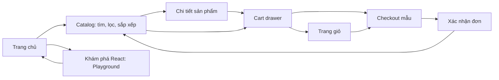

# Nâng cấp demo bán hàng SE347 — thiết kế sản phẩm và UI/UX

> **Cập nhật được người dùng xác nhận khi triển khai 18/11/2026:** tên chính thức **OneSip**; dựng trực tiếp một MVP theo hướng A, bỏ bước nhiều draft/chờ chọn. Vẫn dùng React. Bổ sung QR chuyển khoản MBBank tới tài khoản `0825730557`, chỉnh được số tiền được mã hóa trong QR, cùng skeleton loading khi tải trang. QR tạo hoàn toàn local theo VietQR; không dùng API gửi số tài khoản ra ngoài. Checkout và receipt ghi chờ thanh toán, không giả lập xác nhận tiền đã vào. Addendum này ưu tiên hơn các đoạn đề xuất tên Một Ngụm/duyệt wireframe/chỉ hai dependency ở bản kế hoạch gốc.

Ngày: **18/11/2026 — Asia/Saigon**. Trạng thái: **đã triển khai MVP; xem [bằng chứng kiểm tra](../../onesip-verification.md)**. Các mục dự kiến bên dưới giữ lại để đối chiếu lịch sử kế hoạch, không là yêu cầu chọn draft mới.

> **Chốt cuối của người dùng:** giữ bản giao diện trong screenshot (header vàng, CTA cam, chữ xanh, hero still life), cải thiện trên bản đó; không dùng bản redesign thay thế. Ảnh trong menu hiển thị nguyên màu. QR và ô số tiền chỉ xuất hiện sau **Đặt hàng**, trên biên nhận; số tiền chỉnh sửa được và không thay tổng đơn. Người dùng đã yêu cầu push nhánh `feat/complete-storefront` khi hoàn thành; không push/merge `develop`.

**Ràng buộc Git do người dùng xác nhận:** làm việc trên nhánh riêng **`feat/complete-storefront`**, không push vào `develop`. Nhánh này đã được tạo local từ `main@57f3fcc` vì `main` có bản Playground mới hơn `develop@5ce047c`; không đổi hoặc merge vào `develop`.

## 1. Kết quả cần đạt

Biến cửa hàng ba sản phẩm trong React Playground thành một storefront có bản sắc, hoàn thành được chuỗi **khám phá → tìm sản phẩm → xem chi tiết → thêm giỏ → checkout mô phỏng → xác nhận đơn** trên desktop và điện thoại. Trải nghiệm hình ảnh và chuyển động là một phần của đầu ra bắt buộc.

Người dùng đã chọn phạm vi **frontend hoàn chỉnh, checkout mô phỏng**. Yêu cầu trực tiếp: đầu tư UI/UX ấn tượng, dùng skill phù hợp và bổ sung animation. Tên thương hiệu, phong cách, số lượng dữ liệu, cách chia route và thư viện dưới đây là **đề xuất của agent**, chưa phải lựa chọn thẩm mỹ đã được người dùng duyệt.

Đây tiếp tục là repo **seminar React do Quốc Hướng điều phối**. Không tự chuyển nó thành đồ án cuối kỳ của nhóm Tuấn Khang, không tự giao lại việc cho các thành viên.

## 2. Hiện trạng đã kiểm tra

Baseline: repo `D:/Hoc/HK5/SE347-React-Seminar-Demo`, commit `57f3fcc`, nhánh `main`, working tree sạch trước khi tạo tài liệu. Đã đọc source và xem ứng dụng đang chạy tại `127.0.0.1:4173`.

**Audit:** React 19.3.1 + Vite 8.3.5 + JavaScript, CSS thuần; không Tailwind, shadcn, router hay motion library. Có `Icon`, `ProductArt`, `QuantityPicker`, bộ token sáng/tối và React Playground dùng Sucrase. UI hiện theo giấy ấm, xanh sage, serif; ngôn ngữ tiếng Việt. `README.md` và source mới hơn một số mô tả trong `docs/design-notes.md`.

| Quan sát hiện tại | Hệ quả cho thiết kế mới |
| --- | --- |
| Editor chiếm khoảng nửa màn hình, sản phẩm nằm trong preview | Storefront có màn hình đầy đủ; Playground nằm ở route riêng |
| Ba minh họa SVG nhỏ, ba sản phẩm, giỏ cố định bên cạnh | Cần bộ ảnh thống nhất, catalog, trang chi tiết và giỏ theo ngữ cảnh |
| Có props/state, Context, live edit, lỗi biên dịch, reset và memo comparison | Giữ nguyên giá trị giảng dạy và kiểm thử tương ứng |
| `body` có `overflow: hidden`, `.app` cao `100dvh` | Chỉ áp kiểu cố định này trong Playground; storefront cần cuộn trang tự nhiên |
| Compiler chỉ nhận bare import `react`; host modules được cho phép cụ thể | Router và Motion chỉ ở storefront; không đưa vào lesson biên dịch động |
| Test E2E cũ mở `/` và giả định editor xuất hiện | Đổi điểm vào test lesson sang `/#/learn`, giữ nguyên assertion học thuật |

## 3. Brief và phạm vi

- **Sản phẩm:** cửa hàng đồ uống và vật dụng uống nước, kế thừa dữ liệu hiện tại — nguồn: code.
- **Đối tượng:** người thử demo, bạn học và giảng viên; cần hiểu cách mua mà không có người chỉ dẫn — giả định thiết kế.
- **Việc chính:** tìm món phù hợp, kiểm tra sản phẩm, đặt một đơn mẫu — người dùng đã chọn.
- **Nền tảng:** desktop để trình chiếu, mobile để tự trải nghiệm — đề xuất.
- **Khác biệt thị giác:** cảm giác một cửa hàng nhỏ được chăm chút, ảnh studio và chi tiết biên nhận — đề xuất.

**Bắt buộc trong bản hoàn chỉnh:** trang chủ, catalog tìm/lọc/sắp xếp, chi tiết sản phẩm có URL, cart drawer, trang giỏ, guest checkout, xác nhận đơn, lưu giỏ, dark mode, trạng thái lỗi/rỗng, responsive, motion, truy cập Playground, tài liệu và video mới.

**Chưa đưa vào đợt này:** tài khoản, backend/database, thanh toán tiền thật, quản trị, đánh giá khách hàng, wishlist, mã giảm giá, gợi ý bằng AI, biến thể size/màu. Mỗi sản phẩm là một SKU cố định. Không tạo menu, bộ chọn hay nút cho tính năng chưa có.

## 4. Hướng hình ảnh đề xuất

Tên tạm: **Một Ngụm**. Câu mở đầu thử nghiệm: **“Một ngụm nhỏ. Một ngày dễ chịu.”** Không thay thương hiệu trong repo trước khi có bản thiết kế được chọn.

| Hướng | Bố cục khác nhau ở đâu | Đánh đổi |
| --- | --- | --- |
| **A — Cửa hàng biên tập, khuyên dùng** | Hero lệch 5/7, ảnh tĩnh vật lớn, bộ sưu tập ngắn, lưới hàng rõ ràng | Cần ảnh chất lượng và kiểm soát khoảng trắng tốt |
| B — Catalog đi thẳng vào mua | Tìm kiếm và bộ lọc lên đầu, sản phẩm xuất hiện ngay, hero rất gọn | Nhanh, dễ trình bày; ít dấu ấn thương hiệu hơn |
| C — Bộ sưu tập theo câu chuyện | Một sản phẩm nổi bật mỗi section, xen ảnh sử dụng, dẫn dần vào catalog | Nhiều cuộn và asset hơn; khó đi hết trong demo ngắn |

Khi thực thi: dựng **2–3 wireframe khác bố cục thật** cho Home, catalog và chi tiết, có cả mobile; đánh dấu A khuyên dùng. Sau khi chọn mới làm hi-fi. Không bắt người dùng chọn chỉ từ tên ba phong cách.

Ngân sách thẩm mỹ cho A:

- Giữ nền `--canvas #f7f6f2`, surface `#fffefa`, chữ `#292e27`, CTA `#2c3429`, sage `#829779` từ token hiện có. Peach chỉ xuất hiện trong ảnh/bề mặt phụ; không thành màu CTA thứ hai.
- Đề xuất **Lora cho display**, **Be Vietnam Pro cho nội dung**, font code hiện có giữ cho Playground. Self-host WOFF2 có glyph tiếng Việt, giữ giấy phép; kiểm tra dấu và weight trước khi chốt. Đây là lựa chọn riêng cho storefront, không áp trần typography của dashboard vào hero bán hàng.
- Body và input 16px; tên card 18px; giá card 18–20px; display desktop 64–88px, mobile 38–48px. Không cắt tên sản phẩm thành một dòng để ép bố cục.
- Max-width 1280px; lề mobile 20px, desktop 40–64px; nhịp spacing 4/8/12/16/24/32/48/64/96px. Khoảng cách lớn dành cho hero/section; form và cart gọn hơn.
- Radius 8/16/24px; card hàng chủ yếu tách bằng ảnh và khoảng trắng. Shadow chỉ để tách lớp nổi. Một bộ icon nét thống nhất; dùng `Icon.jsx` đã có và bổ sung glyph cần thiết.
- Dark mode là phiên bản được thiết kế: giữ màu ảnh, đổi canvas/surface/ink bằng token; kiểm lại contrast và bề mặt ảnh, không đảo màu toàn trang.

### Asset cần sản xuất

Một ảnh hero tĩnh vật, 12 ảnh sản phẩm và ảnh phụ cho ba sản phẩm nổi bật. Dùng cùng hướng sáng, bóng mềm, màu nền và tỷ lệ vật thể. Crop hero 8:5, ảnh card 4:5, chi tiết dùng cùng master ảnh với crop riêng. Ảnh là visual sản phẩm; giá và nhãn luôn là HTML.

Ưu tiên ảnh do nhóm có quyền dùng; nếu thiếu, tạo bộ ảnh studio bằng skill `imagegen` trong giai đoạn thực thi và ghi nguồn. Không lấy ảnh thương hiệu tham khảo làm asset bán hàng. Ảnh được tối ưu local WebP/AVIF, có kích thước khai báo, responsive sources; ảnh dưới fold lazy-load, hero được ưu tiên. Mục tiêu hero ≤250KB, thumbnail ≤70KB, ảnh chi tiết ≤160KB mỗi biến thể; kiểm bằng file thật.

Đầu ra ảnh là một **bộ thống nhất**; không dùng 12 ảnh stock lệch màu hoặc kéo giãn ba SVG cũ để lấp catalog. SVG hiện có tiếp tục dùng trong lesson và làm fallback phù hợp.

## 5. Màn hình và hành trình

| Màn / route trong hash | Quyết định chính | Nội dung và hành động |
| --- | --- | --- |
| `/` | Mua gì, cửa hàng có gu gì? | Hero ảnh lớn, CTA “Chọn món”, ba nhóm hàng, bốn sản phẩm tuyển chọn, footer gọn có lối vào React |
| `/shop` | Chọn sản phẩm theo tên/giá/nhóm | Search luôn thấy, category chips, số kết quả, sort, lưới ảnh; thao tác thêm nhanh số lượng 1 |
| `/products/:slug` | Sản phẩm này có phù hợp? | Breadcrumb, gallery, tên, giá, dung tích/chất liệu, mô tả, tồn mẫu, quantity và CTA; tối đa ba món cùng nhóm |
| Drawer | Đã thêm đúng món chưa? | Dòng vừa thêm, sửa lượng/xóa, tạm tính/phí/tổng, “Xem giỏ” và “Đặt đơn mẫu”; giữ bối cảnh trang |
| `/cart` | Kiểm lại đơn trước checkout | Danh sách dễ sửa, summary sticky trên desktop; giải thích phí rõ ràng |
| `/checkout` | Điền và xác nhận đơn | Một trang guest checkout: họ tên, điện thoại, địa chỉ, ghi chú tùy chọn, summary, một phương thức “Thanh toán khi nhận hàng — mô phỏng”, nút “Đặt đơn mẫu” |
| `/orders/:orderId` | Đơn có được tạo chưa? | ID, thời gian, snapshot các dòng, phí và tổng; nhãn đơn mẫu; CTA tiếp tục mua và xem React |
| `/learn` | Giải thích React bằng code đang chạy | Playground hiện tại; bổ sung lối về cửa hàng và trạng thái đang ở khu học React |
| `*`, slug sai, order sai | Tiếp tục được từ URL không hợp lệ | Trang 404 có CTA về catalog; không màn trắng |

**Desktop:** catalog bốn cột từ 1200px, ba cột 900–1199px, hai cột 640–899px. Detail hai cột từ 900px; cart/checkout có summary bên phải. Nội dung được cuộn, header sticky cao vừa đủ, không cố ép toàn bộ shop vào 720px.

**Mobile 375–639px:** catalog hai cột với ảnh đủ lớn, tên hai dòng; nếu tên/giá không đọc tốt ở 375px thì dùng một cột ở breakpoint nhỏ hơn được kiểm thực tế. Search ở hàng riêng, chip cuộn trong vùng riêng. Detail một cột, CTA mua sticky có safe-area; không che footer/form hay focus. Cart drawer gần đầy màn, có nút đóng rõ. Checkout một cột, input font 16px, không bắt kéo ngang.

**Điều hướng:** logo về Home, Back giữ filter/query và vị trí cuộn catalog; route mới đặt focus vào heading, trang mới cuộn đầu; browser Back/Forward khôi phục vị trí đã lưu. Drawer đóng trả focus về trigger, khóa nền, Escape hoạt động. Chỉ một overlay modal được mở tại một thời điểm.

## 6. Dữ liệu và quy tắc mua hàng

Storefront dùng catalog riêng; `src/data/products.js` của lesson giữ nguyên P01/P02/P03 và giá 50.000/25.000/10.000đ. Bản storefront chứa lại ba mặt hàng đó và thêm chín mặt hàng mẫu; không mở rộng dataset mà lesson đang import.

Catalog được lưu bằng số nguyên VND. Mỗi `Product` có `id`, `slug`, `name`, `category`, `price`, `stock`, `description`, `specs`, `images`, `featured`. Category: `drinks`, `coffee`, `accessories`. ID và slug duy nhất, tồn mẫu 0–99. `images` gồm local path, alt và kích thước.

Seed bổ sung đề xuất: cà phê sữa 29.000đ, cold brew 39.000đ, matcha latte 39.000đ, trà vải 29.000đ, trà chanh 19.000đ, cacao sữa 35.000đ, ly giữ nhiệt 89.000đ, ống hút inox 15.000đ, túi đựng bình 25.000đ. Cacao sữa có stock 0 để minh họa hết hàng. Đây là dữ liệu giả, không là giá bán hay tuyên bố thương mại thật.

- Search theo tên, không phân biệt hoa/thường/dấu tiếng Việt, gồm `đ → d`; trim khoảng trắng. Filter category và available; sort `featured`, `price-asc`, `price-desc`, `name`. Query `q`, `category`, `sort`, `available` lưu trên URL hash; giá trị không hợp lệ về mặc định.
- Một dòng giỏ theo `productId`; số lượng nguyên **1..min(stock,99)**. Thêm trùng gộp dòng; tăng vượt ngưỡng giữ ngưỡng, thông báo rõ. Số lượng 0 chỉ đạt được qua thao tác Xóa, không tự biến mất khi giảm.
- `totalQuantity` là tổng đơn vị, không phải số dòng. Giá, tổng và trạng thái hết hàng luôn suy ra từ catalog và cart; không lưu nhiều state tổng tiền.
- Phí mẫu: 20.000đ nếu `0 < subtotal < 150.000đ`; miễn phí khi `subtotal >= 150.000đ`; giỏ trống phí 0. Không thêm thuế, coupon hoặc phí khác.
- Fixture nghiệm thu: P01 ×2 + P02 ×1 → 3 đơn vị, subtotal 125.000đ, ship 20.000đ, total **145.000đ**. P01 ×3 → subtotal 150.000đ, ship 0, total **150.000đ**. Lesson vẫn hiện 125.000đ vì không có phí.
- Stock là dữ liệu mẫu cố định dùng để giới hạn giỏ; không mô phỏng kho thay đổi giữa nhiều khách, không trừ kho lâu dài sau mỗi đơn.

### Checkout, lưu trữ và reset

- Form bắt buộc: tên sau trim 2–80 ký tự; điện thoại sau bỏ khoảng trắng/dấu gạch là `0` + 9 chữ số hoặc `+84` + 9 chữ số; địa chỉ 10–200 ký tự. Note tối đa 300 ký tự. Lỗi cạnh field, summary lỗi khi submit, focus field lỗi đầu. Không ép người dùng tạo tài khoản.
- Có nút **“Điền thông tin mẫu”**, điền một bộ dữ liệu hư cấu. Checkout luôn ghi **“Đây là đơn hàng mô phỏng, không phát sinh thanh toán.”** Không yêu cầu thông tin thẻ.
- Khi submit, snapshot cart và khóa sửa/submit; mock service xử lý 350ms để thể hiện pending có chủ đích. Mỗi lần đặt dùng `attemptId` ổn định; bấm hai lần cùng attempt trả một receipt. Error không xóa giỏ/form; thử lại cùng attempt. Rời checkout khi pending hủy qua AbortSignal, giữ giỏ; trở lại tạo attempt mới. Chỉ success mới ghi receipt và clear cart.
- Giỏ rỗng vào checkout → về `/cart` kèm giải thích. Ảnh lỗi có fallback không đổi tỷ lệ; catalog không kết quả có “Xóa bộ lọc”. Lỗi xử lý đơn có retry. Scenario lỗi thử bằng `/#/checkout?scenario=error`: lần đầu của mỗi attempt thất bại, retry cùng attempt thành công; không tạo lỗi ngẫu nhiên trong luồng chính.
- `localStorage`: `se347.storefront.cart.v1` và `se347.theme.v1`. Chỉ lưu ID/quantity/theme. Đọc schema có kiểm tra, bỏ ID lạ, gộp trùng, clamp stock; JSON hỏng về giỏ trống. Storage bị chặn/quota hết vẫn hoạt động trong bộ nhớ và báo một lần giỏ sẽ không được giữ sau reload.
- Draft tên/điện thoại/địa chỉ chỉ giữ trong memory khi còn ở storefront; không lưu vào browser storage. Confirmation chỉ cần ID/thời gian/dòng hàng/tổng, không hiển thị thông tin giao hàng, nên reload không làm thiếu phần bắt buộc.
- `sessionStorage`: tối đa **một receipt gần nhất** ở `se347.storefront.receipt.v1`, không chứa draft. Nếu sessionStorage không ghi được, success vẫn có receipt trong memory; reload khi đó hiển thị trạng thái không tìm thấy đơn và CTA về catalog.
- “Đặt lại cửa hàng” đặt ở khu demo `/learn`: xóa đúng cart/receipt của app, draft và attempt đang có, trở về Home; giữ theme, không xóa storage khác. “Đặt lại code” giữ nghĩa cũ trong Playground, không xóa đơn/cửa hàng.

## 7. Motion: điểm nhấn có mục đích

CSS cho hover/press/focus, Motion cho enter/exit có vòng đời React và chuyển dòng giỏ. Dùng một hệ token mở rộng `src/tokens.css`; không thêm GSAP, Lenis hoặc một motion stack khác.

| Vị trí | Mục đích / thông số đề xuất | Reduced motion |
| --- | --- | --- |
| Hero khi vào Home lần đầu | Ảnh/heading fade + translateY 12px, 280ms, stagger 50ms, chỉ một lần mỗi mount | Fade 120ms, không dịch chuyển |
| Product card hover | Ảnh scale 1 → 1.025 trong 160ms; chỉ fine pointer/hover | Không scale; đổi viền/nền nhẹ |
| Nút bấm | Scale 0.98 khi pointer press, 120ms; đổi màu theo trạng thái | Chỉ đổi màu |
| Chuyển route sang chi tiết | Nội dung vào opacity + translateY 8px, 200ms; không chờ exit mới cho tương tác | Fade 100ms |
| Thêm hàng | Giỏ/badge cập nhật ngay; drawer mở và highlight dòng vừa thêm 180ms | Hiện ngay/fade ngắn |
| Cart drawer | TranslateX 100% → 0, opacity backdrop, 260ms; đóng theo cùng hướng, thao tác ngắt được | Fade 120ms, không trượt |
| Xóa dòng giỏ | Exit opacity/transform 160ms, các dòng còn lại đổi vị trí bằng layout transform 180ms | Thay đổi ngay, không reflow animation |
| Xác nhận đơn | Checkmark SVG opacity/scale 0.95 → 1, 240ms một lần; biên nhận xuất hiện sau 50ms | Fade ngắn, không scale |
| Bộ đếm/tổng tiền/ô nhập/memo | Giá trị cập nhật tức thì, tabular-nums; không đếm số chạy hay animate dữ liệu đang đọc | Giống bản thường |

Easing UI: `cubic-bezier(0.23,1,0.32,1)`; drawer: `cubic-bezier(0.32,0.72,0,1)`. `transform` và `opacity` là mặc định; không `transition: all`, không animate width/top/left. Hero không ẩn nội dung chờ scroll; không scroll hijack, cursor tùy biến, parallax liên tục hoặc confetti phủ checkout. Keyboard activation không thêm press animation hoặc độ trễ focus; mở/đóng overlay bằng keyboard thực hiện ngay.

Ba khoảnh khắc cần đầu tư nhất: **ảnh hero và khoảng thở**, **chi tiết sản phẩm + drawer mượt**, **biên nhận sau đặt đơn**. Animation bổ trợ các điểm này, không bù cho ảnh hoặc bố cục yếu.

## 8. Kiến trúc và bảo toàn seminar

Giữ React/Vite/JavaScript/CSS thuần. Đề xuất thêm đúng hai runtime dependencies: **`react-router`** cho HashRouter và **`motion`** cho chuyển động React; chọn bản stable tương thích runtime khi thực thi, pin chính xác trong lockfile. HashRouter cho deep link trên static host mà không cần server rewrite. Không nâng React/Vite hay chuyển sang Next.js/TypeScript/Tailwind trong đợt này.

`src/App.jsx` mới làm route boundary. Chuyển App hiện tại nguyên chức năng vào `src/features/learn/LearnApp.jsx`, sửa relative imports. Lazy-load LearnApp để Sucrase/editor không nằm trong đường tải Home. Storefront có `StorefrontProviders` giữ cart/draft/order riêng; không dùng chung `lessons/shop/CartContext.jsx`. Theme điều phối ở root bằng token; metrics vẫn chỉ nằm trong lesson render.

CSS chia thành global reset/token nhẹ, CSS storefront và CSS lesson scoped dưới `.learn-app`. Không import CSS lesson global khi chỉ mở Home. Cần kiểm thứ tự `/learn → shop` để chắc lazy-loaded stylesheet không làm storefront bị `overflow:hidden` hoặc cao cố định. Không đổi allowlist compiler chỉ để nhập router/motion vào lesson.

Không yêu cầu lesson có đầy đủ checkout để tránh code học viên trở nên khó đọc. Label lối vào “Khám phá React”; lời dẫn nói rõ lesson là phiên bản rút gọn của các nguyên lý đang dùng trong cửa hàng. Giữ fixture lesson 125.000đ, phép đo 5/0 → 6/1 và live-edit có thể bỏ `memo`.

## 9. Tiêu chí nghiệm thu

- Hoàn thành luồng mua hàng bằng pointer và chỉ bàn phím, có thể làm lại lần hai; không nút giả hoặc dead-end.
- Home/detail/cart/checkout/confirmation đều có screenshot desktop và mobile, sáng/tối; chọn thiết kế bằng hình thực trước khi triển khai hàng loạt.
- Kiểm 375×812, 390×844, 768×1024, 1280×720, 1440×900 và 1920×1080: không tràn ngang, không sticky che field/nút, dialog có focus đúng. Playground tiếp tục vừa viewport desktop như bản cũ.
- Contrast mục tiêu 4.5:1 cho chữ thông thường; vùng bấm ≥44×44px; focus nhìn được; label/alt/aria-live cho thay đổi giỏ; không dùng màu đơn độc báo lỗi.
- Thử reduced motion thực tế, đóng/mở drawer nhanh, bấm thêm liên tiếp, tên dài, hết hàng, ảnh hỏng, query sai, JSON storage hỏng và storage không khả dụng.
- Không request ngoài localhost trong luồng sau khi cài/build. Ảnh/font/motion assets chạy local. Test browser vẫn chặn mạng ngoài nhưng cho request asset local.
- Mục tiêu hiệu năng: CLS ≤0.1, LCP ≤2.5s, INP ≤200ms là ngưỡng tham chiếu. Trước deploy dùng kiểm tra lab lặp lại ba lần cùng cấu hình và ghi median; không gọi Lighthouse hay một phép đo localhost là field Core Web Vitals. Home không tải Sucrase trước khi vào `/learn`.
- `npm run lint`, `npm test`, `npm run build`, `npm run test:e2e` qua trên bản mới; test seminar giữ ý nghĩa. Video và tài liệu phải quay/viết lại theo UI thực.

## 10. Thứ tự ưu tiên và mức đầu tư

| Chặng | Đầu ra có thể review | Ước lượng làm tập trung |
| --- | --- | --- |
| 1. Chốt hình ảnh và bố cục | 2–3 wireframe, hi-fi Home/detail/mobile, bộ token và asset direction | 2–3 buổi |
| 2. Nền app và khám phá hàng | Tách Learn, route, catalog và detail chạy thật | 2–3 buổi |
| 3. Hoàn thành giao dịch mẫu | Giỏ, persistence, checkout, confirmation và recovery | 2–3 buổi |
| 4. Motion và kiểm chất lượng | Ba điểm nhấn, dark/mobile, performance, regression, video | 2–3 buổi |

Một buổi khoảng 3–4 giờ cho một người triển khai đã quen React; tổng **24–48 giờ** là ước lượng lập kế hoạch, không là cam kết lịch. Số vòng sửa ảnh và thiết kế ảnh hưởng lớn nhất. Không suy ra deadline mới từ ngày seminar cũ 18/11. Có thể nghiệm thu từng chặng, nhưng chỉ chặng 4 mới đạt yêu cầu “demo hoàn chỉnh, UI/UX được đầu tư”.

## 11. Skills và nguồn tham khảo

Đã áp dụng khi lập thiết kế: `ui-ux` (audit, nhiệm vụ mỗi màn, trạng thái, wireframe), `redesign-existing-projects` (nâng cấp theo stack hiện có), `animate` (motion có mục đích, timing, interruption), `brainstorming` và `writing-plans`. Khi sản xuất ảnh dùng `imagegen`; trước bàn giao dùng `verification-before-completion`.

`ui-ux` tập trung app/dashboard, không có mẫu storefront đầy đủ. Vì vậy dùng nó cho hệ thống control, form, overlay và tính nhất quán; hướng hình ảnh storefront được đề xuất riêng dựa trên sản phẩm và ảnh tham khảo. Không áp nguyên bố cục dashboard vào trang bán hàng.

Nguồn chính thức đã đối chiếu ngày 18/11/2026:

- [KINTO: tumblers and bottles](https://kinto-usa.com/pages/tumblers-and-bottles): tham khảo cách nhóm sản phẩm và đưa công năng/dung tích vào quyết định mua; không sao chép thương hiệu, giá hoặc ảnh.
- [React Router: HashRouter](https://reactrouter.com/api/declarative-routers/HashRouter): hash location không gửi lên server, hỗ trợ lựa chọn static deployment.
- [React Router: declarative installation](https://reactrouter.com/start/declarative/installation): thêm routing vào React app hiện hữu.
- [Motion: AnimatePresence](https://motion.dev/docs/react-animate-presence): quản lý exit của phần tử React.
- [Motion: useReducedMotion](https://motion.dev/docs/react-use-reduced-motion): phản hồi tùy chọn giảm chuyển động.
- [WAI-ARIA: modal dialog](https://www.w3.org/WAI/ARIA/apg/patterns/dialog-modal/): focus, Escape và quản lý nền khi mở drawer dạng modal.
- [web.dev: Web Vitals](https://web.dev/articles/vitals): ngưỡng và phân biệt dữ liệu lab/field.

Không có nghiên cứu người dùng hoặc điểm UI được đo trong giai đoạn lập plan này. Các tiêu chí ở trên là đích nghiệm thu, chưa là kết quả đạt được.

Builder check độc lập ngày 18/11/2026: **nothing important left**. Đã tự đối chiếu plan với các màn, quy tắc dữ liệu, motion, ranh giới lesson và ràng buộc Git trong spec; đây là review tài liệu, không thay cho kiểm thử sản phẩm.
